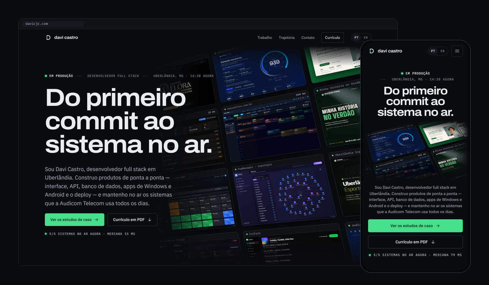
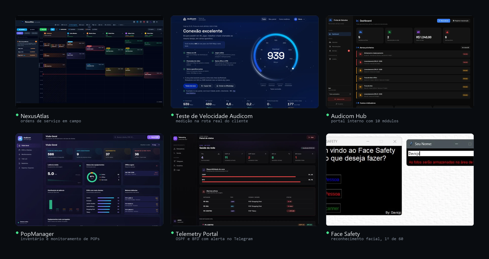
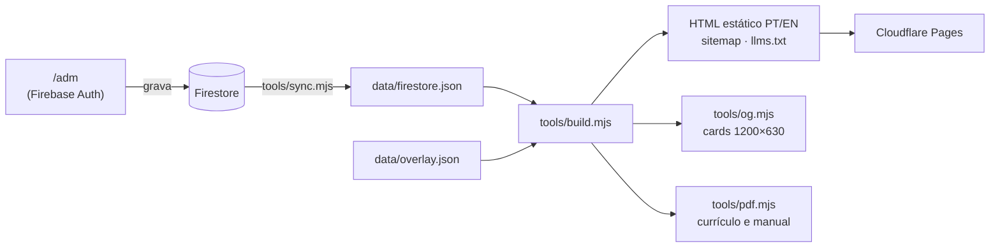

<p align="center">
  <picture>
    <source media="(prefers-color-scheme: dark)" srcset="brand/assinatura-davi-castro.svg">
    
  </picture>
</p>

<p align="center">
  <a href="https://davicjc.com"><b>davicjc.com</b></a> ·
  <a href="https://davicjc.com/en/">English</a> ·
  <a href="https://davicjc.com/Curriculo/">Currículo</a> ·
  <a href="https://davicjc.com/brand/">Manual da marca</a> ·
  <a href="https://orcid.org/0009-0005-8485-455X">ORCID</a>
</p>

<p align="center">
  
</p>

Portfólio de **Davi Castro**, desenvolvedor full stack em Uberlândia (MG). O site mostra os sistemas que eu construí e mantenho no ar, com telas reais, a situação de cada projeto e os números que dá para conferir. No topo, uma parede de telas acende quando cada sistema responde ao ping, medido no navegador de quem visita.

## O que tem aqui

| Página | O que é |
| --- | --- |
| [`/`](https://davicjc.com) e [`/en/`](https://davicjc.com/en/) | Home em português e inglês: parede de produção, estudos de caso, entregas, trajetória e contato |
| [`/projetos/`](https://davicjc.com/projetos/) | 26 projetos, cada um com página própria nas duas línguas e a situação de hoje (no ar, em desenvolvimento, descontinuado…) |
| [`/Curriculo/`](https://davicjc.com/Curriculo/) | Currículo em PT e EN gerado dos mesmos dados, com PDF de duas páginas |
| [`/brand/`](https://davicjc.com/brand/) | Manual da marca, com PDF de 12 páginas e os arquivos para baixar |
| [`/coffee/`](https://davicjc.com/coffee/) | Me pague um café: Pix com QR gerado na hora, PayPal e cripto |
| `/adm/` | Painel que edita todo o conteúdo (Firebase Auth + Firestore) |

<p align="center">
  
</p>

## Como funciona



O conteúdo mora no Firestore e é editado no `/adm`. O site em si é estático: `tools/build.mjs` lê o banco e gera todas as páginas, o sitemap com `hreflang` e imagens, o `llms.txt`, o currículo e o café. Nada de framework e nenhuma dependência: só Node 20+ e, para os cards e PDFs, o Chrome instalado.

A automação [`atualizar.yml`](.github/workflows/atualizar.yml) roda de hora em hora: puxa o banco, refaz o site e publica só quando algo mudou. O build é determinístico (a data vem do conteúdo, não do relógio), então rodar duas vezes, aqui ou no CI em UTC, gera exatamente os mesmos arquivos.

## Rodar na sua máquina

```bash
node tools/sync.mjs        # puxa o Firestore (leitura pública) para data/firestore.json
node tools/build.mjs       # gera as páginas
node tools/og.mjs          # cards de compartilhamento (usa o Chrome)
node tools/pdf.mjs         # PDFs do currículo e do manual da marca (usa o Chrome)
npx serve .                # ou: python -m http.server 8000
```

As páginas usam caminhos absolutos (`/assets/...`), então sirva a partir da raiz do repositório. Para regenerar a marca, rode `node tools/tokens.mjs` depois de mexer em `brand/tokens.json`, e `python brand/gerar-marca.py` para refazer SVGs e ícones (precisa de fontTools, uharfbuzz, PyMuPDF e Pillow).

## Decisões

- **Conteúdo honesto.** Cargos e datas seguem o ORCID. Todo projeto declara a situação, e projeto parado não some. Telas de sistemas internos usam dados fictícios, gerados rodando o próprio sistema.
- **SEO de verdade num site estático.** Uma URL por página e por língua, `hreflang` nos dois sentidos, JSON-LD (`Person` com ORCID, `SoftwareApplication`, `BreadcrumbList`, `ProfilePage`), sitemap com imagens, `llms.txt` e um card de compartilhamento próprio para cada página.
- **Leve.** Fontes auto-hospedadas em subconjunto latino, imagens WebP com `srcset` de 800 e 1200 px, um CSS e um módulo JS por página.
- **Acessível.** Contraste AA medido em todas as superfícies, foco visível, abas e escolhas que funcionam pelo teclado, e com `prefers-reduced-motion` tudo aparece direto no estado final.
- **Pedido guiado.** Em `/pedido/` (e `/en/order/`) o cliente escolhe a análise rápida (6 perguntas) ou a completa (15), e cada resposta redesenha ao vivo a maquete do projeto dele. O pedido sai pronto pelo WhatsApp ou por e-mail. A gravação no Firestore fica desligada em `data/pedido.json` até as regras de `firestore.rules` serem publicadas, porque hoje a leitura do banco é pública.
- **Marca como sistema.** `brand/tokens.json` é a fonte única de cores, tipos, espaços e movimento. Site, manual, currículo, cards e ícones leem dali.

## Estrutura

```
📦 PortfolioPessoal
├── tools/
│   ├── sync.mjs            # Firestore → data/firestore.json
│   ├── build.mjs           # gera o site inteiro
│   ├── tpl/                # templates: home, projeto, lista, currículo, café, pedido, manual da marca
│   ├── og.mjs · og.html    # cards de compartilhamento
│   ├── pdf.mjs             # PDFs a partir das próprias páginas
│   └── tokens.mjs          # brand/tokens.json → assets/css/tokens.css
├── data/                   # retrato do banco, overlay, café, pedido, números do GitHub
├── assets/                 # CSS, JS (site, easter egg, café, QR, pedido), fontes e cards
├── brand/                  # tokens, SVGs da marca, ícones, gerador e manual em PDF
├── adm/                    # painel do conteúdo e dos pedidos
├── firestore.rules         # regras do banco (publicar pelo console do Firebase)
├── fotos/                  # telas dos projetos (WebP) e fotos dos depoimentos
├── certificados/           # PDFs dos certificados
└── .github/workflows/      # atualização automática do site
```

## Easter egg

Tem um. A dica está no console do navegador.

## Licença

O código (`tools/`, `assets/js/`, `assets/css/`, `adm/`) está sob a [licença MIT](LICENSE): pode estudar e reaproveitar. A marca (`brand/`), os textos, as fotos, as telas dos projetos, o currículo e os certificados são de Davi Castro, com todos os direitos reservados. As fontes Archivo e IBM Plex usam a SIL Open Font License.

---

<p align="center">Feito e mantido por <a href="https://davicjc.com"><b>Davi Castro</b></a> · 2026</p>
